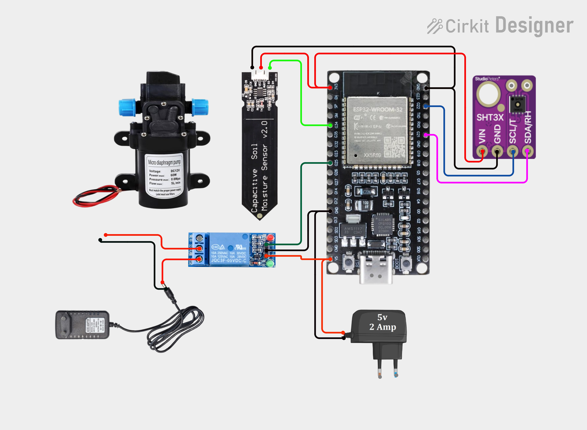

## 1. Hardware Wiring

| Component | ESP32 Pin | Notes |
|---|---|---|
| SHT31 SDA | GPIO 21 | I²C, 400 kHz |
| SHT31 SCL | GPIO 22 | I²C, 400 kHz |
| OLED SSD1306 SDA/SCL | GPIO 21 / 22 | Same I²C bus, addr 0x3C |
| Soil sensor (analog out) | GPIO 34 | 12-bit ADC, 11 dB attenuation |
| Relay 1 (SHT) | GPIO 25 | Active-high/low configurable |
| Relay 2 (Soil) | GPIO 26 | Active-high/low configurable |
| Buzzer | GPIO 27 | Active-high/low configurable |
| LED (anode) | GPIO 33 | PWM-capable (LEDC) |
| BOOT button | GPIO 0 | Hold 5 s = factory reset |

> Power the SHT31 and OLED from 3.3 V. Soil sensor VCC per its datasheet (usually 3.3–5 V); its analog output must not exceed 3.3 V.

## 2. Flash & First Boot

1. Open the `.ino` in Arduino IDE (or PlatformIO). Install libraries:
   - `Adafruit SSD1306`
   - `Adafruit GFX`
   - `Adafruit SHT31`
2. Select board **ESP32 Dev Module**, correct COM port, upload.
3. On first boot the device creates a Wi-Fi AP:
   - **SSID:** `ESP32_SOIL_SHT`
   - **Password:** `12345678`
4. Connect to it and open **http://192.168.4.1** (captive portal should pop up automatically).

## 3. First-Time Configuration (do these in order)

### a) Wi-Fi AP page
- Set your own SSID and a password ≥ 8 characters.
- Click **Apply & restart AP** — you must reconnect with the new credentials.

### b) Soil page — calibrate
1. Put probe in **air**, note the *Raw* value shown in the readout.
2. Put probe in **water**, note the *Raw* value.
3. Enter both into **Calibration raw DRY** / **Calibration raw WET**, then **Save**.
   - DRY should be the higher number (default 3200), WET the lower (default 1400).
4. Set **ON when moisture ≤** (e.g. 30 %) and **OFF when moisture ≥** (e.g. 60 %).

### c) SHT page
- Set temperature/humidity ON and OFF thresholds. OFF must be lower than ON (hysteresis).
- Defaults: ON at 30 °C / 80 %RH, OFF at 26 °C / 60 %RH.

### d) Other pages (Buzzer, LED, OLED)
- Enable/disable, set modes and intervals. OLED pages rotate automatically between sensor and status views.

## 4. Daily Use

- **Dashboard** shows live values, 120-sample history charts, and quick relay buttons (ON / Auto / OFF).
- All settings are saved to NVS with a debounce (~1.5 s) and wear-leveled across two slots; a power cut mid-write cannot corrupt the previous config.
- The status LED on the OLED page and the web top-bar dot show live connection state.

## 5. Maintenance

| Action | How |
|---|---|
| Reboot | System page → **Reboot**, or power cycle |
| Factory reset | System page → **Factory reset**, or hold **BOOT (GPIO 0) for 5 s** |
| Force sensor read | SHT page → **Read now** |
| Test buzzer | Buzzer page → **Test 0.6 s** |
| Advance OLED page | OLED page → **Next page now** |

## 6. Troubleshooting

| Symptom | Check |
|---|---|
| `SHT31 ERR` on OLED | I²C wiring, 3.3 V power, address 0x44 (some modules are 0x45 — not supported here) |
| Soil % stuck at 0 or 100 | Re-calibrate; ensure DRY > WET raw values |
| Relay never clicks | Verify **Active HIGH** setting matches your relay module |
| Web page won't load | Reconnect to AP; try `http://192.168.4.1` directly (not HTTPS) |
| Can't reconnect after changing AP | Wait ~10 s for AP restart, then join the new SSID |
| Heap errors / JSON overflow | Reduce `HISTORY_MAX` or `oledIntervalMs`; check `minHeap` on System page |

## 7. Safety Notes

- The soil relay can switch a pump — use a properly rated relay module and keep mains wiring isolated from the ESP32.
- Do not exceed 3.3 V on GPIO 34 (ADC input).
- The AP is open by default; always set a password before leaving the device unattended.
