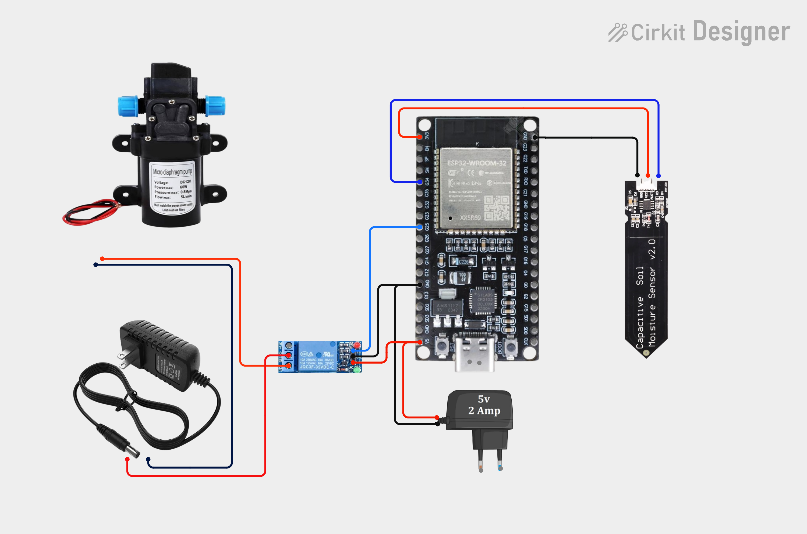

## 1. Hardware Wiring

| Component | ESP32 Pin | Notes |
|-----------|-----------|-------|
| Soil moisture sensor (analog out) | GPIO34 | ADC input only, 3.3V max |
| Relay module (IN) | GPIO25 | Active level configurable in UI |
| Buzzer (active) | GPIO26 | Drives HIGH to beep |
| LED (anode) | GPIO33 | PWM via LEDC, add resistor |
| OLED SDA | GPIO21 | SSD1306 128x64, I2C addr 0x3C |
| OLED SCL | GPIO22 | |
| BOOT button | GPIO0 | Built-in; short press = page, 5s hold = factory reset |

Power the sensor and relay from a stable 3.3V/5V supply as required by your modules. Common ground between ESP32 and all modules.

## 2. First Boot

1. Flash the sketch via Arduino IDE (ESP32 board package, `Adafruit SSD1306` + `Adafruit GFX` libraries installed).
2. On boot the device creates a WiFi access point:
   - **SSID:** `ESP32_Soil_Sensor`
   - **Password:** `12345678`
3. Connect to that AP, then open **http://192.168.4.1** in a browser. Any other URL redirects there (captive portal).

## 3. Initial Calibration (important)

1. Insert the sensor in **dry soil**, wait ~10 s, go to **Soil Moisture** page → click **Set Dry = Current Raw**.
2. Insert in **wet/saturated soil**, wait ~10 s → click **Set Wet = Current Raw**.
3. Set **Relay ON at or below (%)** (default 35%) and **Hysteresis** (default 5%).
4. Click **Save Settings**.

Moisture % = (dry − raw) / (dry − wet) × 100, clamped 0–100.

## 4. Relay Logic

- **Auto mode:** relay turns ON when moisture ≤ threshold, OFF when moisture ≥ threshold + hysteresis.
- **Min ON / Min OFF times** prevent rapid cycling.
- **Manual ON / OFF** overrides from the Dashboard buttons or Soil page.
- Active level (HIGH/LOW) is configurable for both relay types.

## 5. Configuring Subsystems

| Page | What you can set |
|------|------------------|
| **Buzzer** | Enable, trigger (low/high moisture, relay on, periodic), beep/gap ms, count, repeat period |
| **LED** | Enable, mode (Off/On/Blink/Pattern), brightness 0–255, on/off ms |
| **OLED** | Enable, current page, auto-rotate interval (0 = manual), contrast |
| **WiFi AP** | SSID, password (≥8 chars), channel, max clients, hidden, TX power |
| **System** | Save now, reboot, factory reset, firmware version, stats |

## 6. OLED Pages (6 total)

Dashboard → Soil → Buzzer → LED → WiFi → System.  
Short-press **BOOT** to advance. Set auto-rotate on the OLED page (default 10 s). Hold BOOT 5 s for factory reset (release before 5 s to cancel).

## 7. Configuration Persistence

- Settings saved to **dual NVS slots** with CRC32 and sequence numbers (survives power loss; picks newest valid slot).
- Saves are **debounced (2 s)** and **rate-limited (30 s)** to protect flash.
- Stats (relay ON time, sample count) auto-save hourly.
- **Save Config Now** on the System page forces an immediate write.

## 8. Recovery & Protections

- **Watchdog:** 30 s task WDT; device reboots on hang.
- **Heap guard:** if free heap < 4 KB for 60 s, config is saved and device restarts.
- **Factory reset:** System page button or 5 s BOOT hold — erases all NVS config and reboots to defaults.

## 9. Reconnecting After WiFi Changes

After changing SSID/password/channel, the AP restarts ~1 s later. Reconnect to the new SSID and reopen **http://192.168.4.1**.

## 10. Troubleshooting

| Symptom | Fix |
|---------|-----|
| Moisture always 0% or 100% | Recalibrate dry/wet; check GPIO34 wiring and 3.3V |
| Relay never switches | Check active level setting; verify min ON/OFF times aren't blocking |
| No OLED output | Confirm I2C address 0x3C; check SDA/SCL not swapped |
| Can't reach 192.168.4.1 | Ensure you're connected to the ESP32 AP, not another network |
| Settings lost after reboot | Was Save clicked? Saves are debounced — use **Save Config Now** |
| Constant reboots | Check heap/health; verify no short on GPIO25/26/33 |

---

## 📋 COMPLETE WIRING TABLE

| Component | Pin | Connects To | Wire |
|---|---|---|---|
| Soil Sensor | VCC | ESP32 3V3 | Red |
| Soil Sensor | GND | ESP32 GND | Black |
| Soil Sensor | AOUT | ESP32 GPIO34 | Yellow |
| Relay | VCC | ESP32 VIN (5V) | Red |
| Relay | GND | ESP32 GND | Black |
| Relay | IN | ESP32 GPIO25 | Yellow |
| Relay | COM | Pump (−) | Any |
| Relay | NO | PSU (+) | Any |
| Pump | (+) | PSU (+) | Any |
| Pump | (−) | Relay COM | Any |
| PSU | (−) | ESP32 GND (common) | Black |

---

---

## ⚙️ CONFIGURATION AFTER WIRING

### 1. Set relay polarity (if needed)

If the relay turns ON when the dashboard says OFF (and vice versa), edit the top of the `.ino`:

```cpp
#define RELAY_ACTIVE_LOW    false   // ← change from true to false
```
---

### 3. Calibrate the sensor

After first boot, open the dashboard and:
1. Hold sensor **in dry air** → note the **Raw ADC** value → enter as **Dry ADC**
2. Dip sensor **in a glass of water** → note the **Raw ADC** value → enter as **Wet ADC**
3. Set **Threshold** (30% is a good start)
4. Set **Read Interval** (5s is a good start)
5. Click **Save**

---

## 🧪 TESTING CHECKLIST

| # | Test | Expected Result |
|---|---|---|
| 1 | Power on ESP32 | Serial at 115200 (if enabled) shows IP or AP start |
| 2 | Open `http://<IP>/` in browser | Dashboard loads |
| 3 | Sensor in air | Moisture reads ~0–10% |
| 4 | Sensor in water | Moisture reads ~90–100% |
| 5 | Click **ON** (manual) | Relay clicks, pump starts |
| 6 | Click **OFF** | Relay clicks, pump stops |
| 7 | Toggle **AUTO** mode | Relay follows threshold |
| 8 | Save settings | Values persist after power cycle |
| 9 | Open `/wifi` page | WiFi settings load |
| 10 | Scan networks | List of nearby SSIDs appears |

---

## ⚠️ SAFETY NOTES

1. **Never** touch the relay's high-voltage side while powered (if using AC).
2. **Always** use a **common ground** between ESP32 and any external supply.
3. **Do not** power a pump directly from ESP32's 3V3 or VIN — use external supply.
4. **Add a flyback diode** across DC pump terminals (1N4007 or similar) to suppress back-EMF spikes.
5. **Add a 100µF capacitor** across relay VCC/GND if relay causes ESP32 brownouts.
6. **Use a fuse** on the pump's positive supply for overcurrent protection.
7. **Keep** the soil sensor's exposed wires away from mains wiring.
8. **Waterproof** the sensor's connection to the ESP32 if used outdoors.

---
